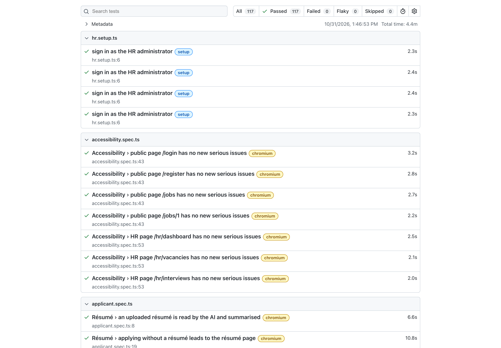
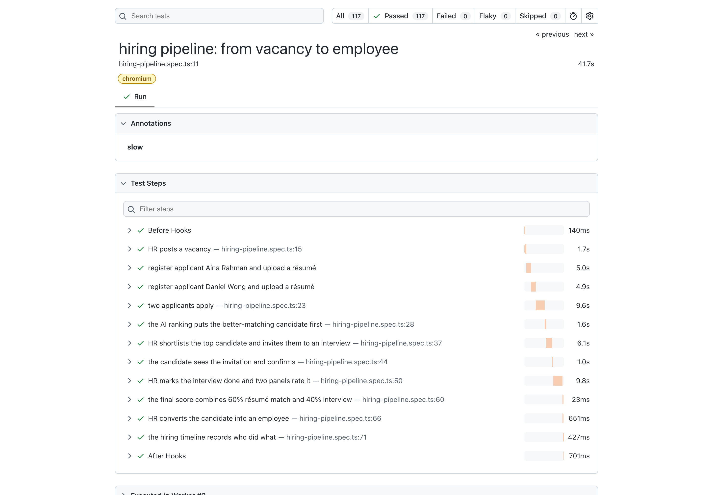
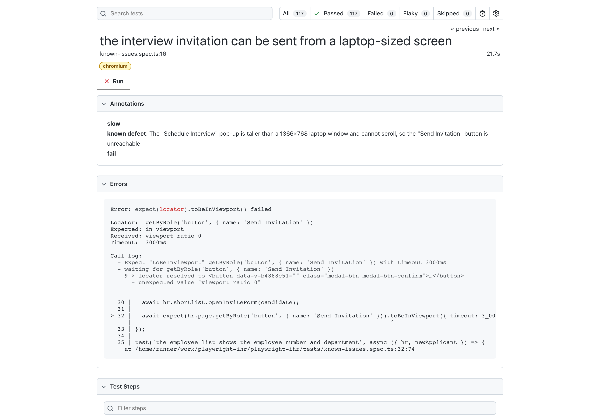
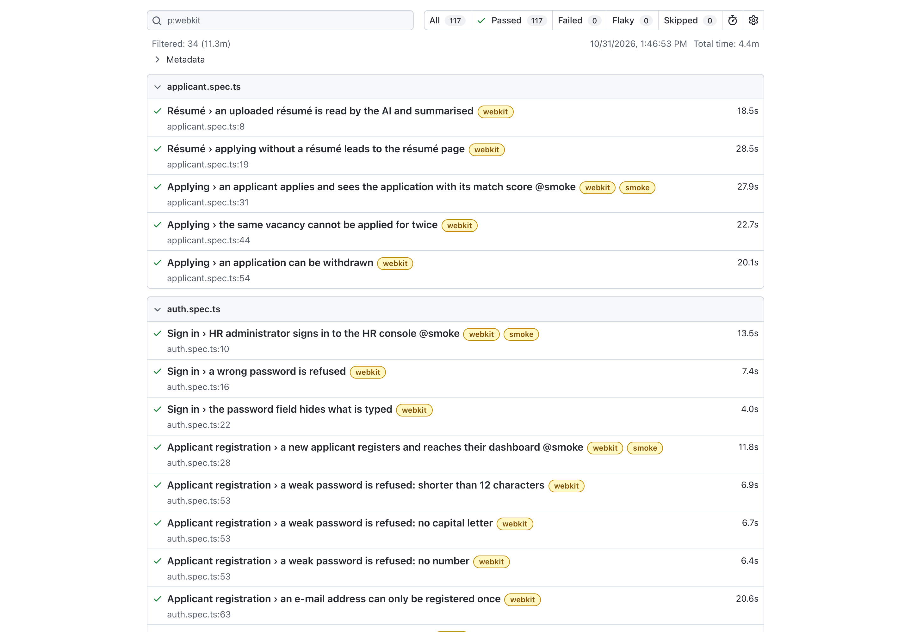
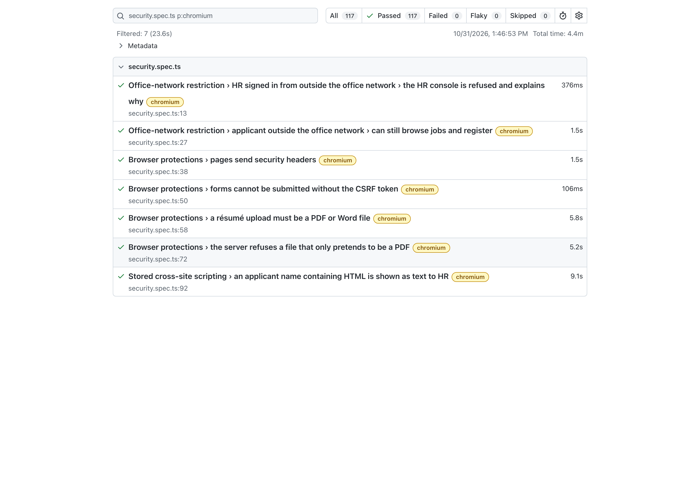
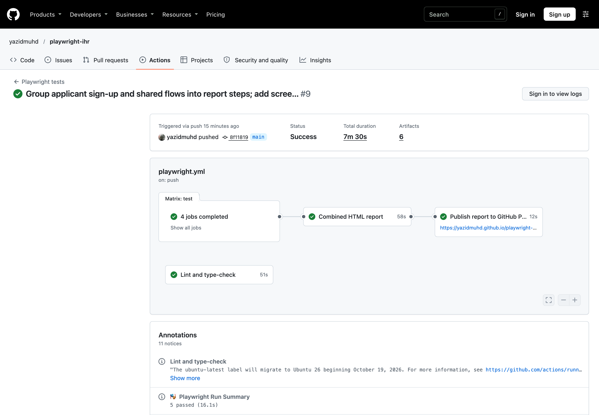

# Playwright end-to-end tests for i-HR

[](https://github.com/yazidmuhd/playwright-ihr/actions/workflows/playwright.yml)

An automated test suite, built with **Playwright** and **TypeScript**, for [**i-HR**](https://github.com/yazidmuhd/ihr): an AI-assisted recruitment system (Laravel, Vue, PostgreSQL) that I built as my final year project. The tests drive the real application in real browsers (Chromium, Firefox, WebKit/Safari and a mobile viewport), the way HR staff and job applicants use it.

**[View the latest test report →](https://yazidmuhd.github.io/playwright-ihr/)**, published automatically after every run on `main`.

## What it tests

The main test follows one hire from start to finish, with **HR and two applicants in separate browsers at the same time**:

```
HR posts a vacancy ─▶ two applicants register, upload résumés, apply
                   ─▶ the AI ranks the better match first (higher score, matching skills)
                   ─▶ HR shortlists and invites ─▶ the candidate confirms the interview
                   ─▶ HR marks it done, two panels rate it 5★ and 4★ ─▶ final score = 60% résumé + 40% interview
                   ─▶ HR converts the candidate to an employee ─▶ the hiring timeline shows who did what
```

| Area                     | File                                                       | Tests | What is checked                                                                                                                                                                                                |
| ------------------------ | ---------------------------------------------------------- | ----: | -------------------------------------------------------------------------------------------------------------------------------------------------------------------------------------------------------------- |
| Sign in and registration | [`auth.spec.ts`](tests/auth.spec.ts)                       |    12 | HR and applicant sign-in, wrong password, password policy (data-driven), duplicate e-mail, mismatched passwords, applicants blocked from HR (403), logout ends the session                                     |
| Job board                | [`job-board.spec.ts`](tests/job-board.spec.ts)             |     5 | Browsing while signed out, vacancy details, search, sign-in required to apply, new vacancies appear immediately                                                                                                |
| Applicant                | [`applicant.spec.ts`](tests/applicant.spec.ts)             |     5 | Résumé upload and AI summary, applying, match score shown, no duplicate applications, withdrawing                                                                                                              |
| Hiring pipeline          | [`hiring-pipeline.spec.ts`](tests/hiring-pipeline.spec.ts) |     1 | The whole journey above, in 9 named steps                                                                                                                                                                      |
| Security                 | [`security.spec.ts`](tests/security.spec.ts)               |     7 | HR console refused outside the office network, applicants still served; security headers; CSRF protection; résumé file-type checks in the browser _and_ on the server; stored XSS through the applicant's name |
| Accessibility            | [`accessibility.spec.ts`](tests/accessibility.spec.ts)     |     7 | axe-core WCAG 2.1 A/AA scans of 7 pages, failing on any _new_ serious issue                                                                                                                                    |
| Known defects            | [`known-issues.spec.ts`](tests/known-issues.spec.ts)       |     4 | Bugs the suite found, tracked as expected failures (below)                                                                                                                                                     |

There are 34 tests on each desktop browser, plus 7 accessibility scans in Chromium and the `@smoke` tests on a mobile viewport: **114 test runs** in total.

## Proof of execution

Screenshots of the [published report](https://yazidmuhd.github.io/playwright-ihr/) and the [GitHub Actions run](https://github.com/yazidmuhd/playwright-ihr/actions) that produced it. Both links are live; the report is regenerated on every push and every day. To refresh these images: `npm run screenshots`.

|                                                                                                                     |                                                                                                                  |
| ------------------------------------------------------------------------------------------------------------------- | ---------------------------------------------------------------------------------------------------------------- |
| **All tests passing across browsers**<br>                  | **The hiring journey as named steps**<br> |
| **A defect found in i-HR, tracked as an expected failure**<br> | **The same tests in WebKit (Safari)**<br>               |
| **Security tests**<br>                                     | **The CI pipeline that ran them**<br>           |

## Defects found in i-HR

Writing these tests uncovered real bugs. Each has a test that asserts the _correct_ behaviour, marked `test.fail()` with a description. The suite stays green while the bug exists and turns red the day it's fixed.

| Defect                                                                                       | Impact                                                     | Test                                                              |
| -------------------------------------------------------------------------------------------- | ---------------------------------------------------------- | ----------------------------------------------------------------- |
| The "Schedule Interview" pop-up is taller than a 1366×768 laptop screen and can't scroll     | HR on a common laptop **can't send interview invitations** | `the interview invitation can be sent from a laptop-sized screen` |
| The employee list shows "-" for Employee No and Department; the query never selects them     | Hired staff appear without their number or department      | `the employee list shows the employee number and department`      |
| The public job board shows the applicant menu and a **Logout** button to signed-out visitors | Confusing navigation for first-time visitors               | `signed-out visitors are not offered a Logout button`             |
| Pop-ups have no `role="dialog"`                                                              | Screen readers don't announce them                         | `confirmation pop-ups are announced as dialogs`                   |

Accessibility scans also report these **serious or critical** issues. They're recorded as the known baseline, so only _new_ issues fail the build:

- The show-password buttons on the login and registration pages have no label (`button-name`).
- The filter drop-downs on the job board and the vacancy list have no label (`select-name`).
- The HR dashboard has no page title (`document-title`).
- Low text contrast on badges and hints appears across the site (`color-contrast`).

Outside the scans: the star-rating buttons on the evaluation page are announced only as "★", so a screen-reader user can't tell which rating each one gives.

## How it works

```
Playwright ──▶ e2e-server/start.mjs
                 ├─ mock AI service (stands in for OpenRouter)          :4010
                 ├─ PostgreSQL test database, reset and seeded each run
                 └─ i-HR on PHP's built-in server, configured for tests  :8090
```

- **The real application, untouched.** Playwright's `webServer` starts i-HR from its own repository. Test settings come only from environment variables: a fresh database, the mock AI, and a known HR account.
- **AI without the AI bill.** i-HR sends résumé text to an AI model. In tests, a [small mock server](e2e-server/mock-ai.mjs) answers in the same format as OpenRouter, building its reply from labelled lines in the [test résumés](fixtures/). Results are fast, free, offline and predictable.

## Design decisions

- **Users as fixtures.** Tests receive `hr` (a signed-in HR browser with its page objects) and `newApplicant()` (registers a brand-new applicant through the sign-up form, in a browser of their own). Multi-user stories read naturally:
  ```ts
  const strong = await newApplicant({ resume: RESUMES.strongMatch });
  await applyFor(strong, vacancy.title);
  await hr.vacancies.openRanking(vacancy.title);
  ```
- **Page Object Model.** Each screen is a class ([`src/pages`](src/pages)), so selectors live in one place. i-HR has no test ids, so elements are found the way users find them: by role, label and visible text.
- **Every browser has its own IP address.** i-HR limits sign-ups to 10 per hour per IP and only lets the "office network" reach HR pages. Each browser context sends its own `X-Real-IP` (an address in 127.0.0.0/8), so parallel tests don't share rate limits. A single test can still pretend to be outside the network.
- **Parallel-safe data.** Every test creates its own vacancies and applicants with unique names and e-mails, so tests can run in any order, three at a time.
- **No shared session for destructive tests.** HR tests reuse a saved session for speed. The logout test signs in separately, because logging out the shared session would sign out every HR test running alongside it. A flaky run showed this ("419 Page Expired") until it was fixed.
- **Waiting for background saves.** Some i-HR screens update instantly and save in the background (e.g. star ratings), then reload the page's data. [`untilSaved()`](src/support/saves.ts) waits for that whole round trip before the next action. Clicking on too early either cancelled the save or let the reload close a dialog that had just opened.
- **Lasting results over passing messages.** Tests assert outcomes that stay on screen, such as status "scored" or a "Re-apply" button, not success messages that fade.
- **Accessibility as a ratchet.** Known axe findings form a baseline, and a test fails only on new serious issues. As i-HR fixes an issue, it's removed from the list, so the bar only rises.

## Running locally

You need Node.js 20+, PHP 8.2+ with Composer, and PostgreSQL.

```bash
# 1. The application under test, next to this repository
git clone https://github.com/yazidmuhd/ihr ../ihr
cd ../ihr && composer install && npm ci && npm run build && cp .env.example .env && php artisan key:generate && cd -
createdb ihr_e2e

# 2. The tests
npm ci
npx playwright install
cp .env.example .env            # set IHR_APP_DIR if i-HR is somewhere else

npm test                        # everything; starts i-HR automatically
npm run test:chromium           # one browser
npm run test:smoke              # quick @smoke subset
npm run test:ui                 # Playwright's interactive UI mode
npm run report                  # open the last HTML report
```

`npm run ihr:start` starts i-HR, the test database and the mock AI on their own, for exploring at http://127.0.0.1:8090. The test HR account is `humanres` / `E2e-Hr-Password-2026`.

## Continuous integration

[GitHub Actions](.github/workflows/playwright.yml):

1. Checks out this repository and **i-HR's latest `main`**. Any branch, tag or commit can also be chosen when starting a run by hand.
2. Starts PostgreSQL, installs PHP and builds i-HR.
3. Runs lint, type checks and formatting checks.
4. Runs each browser in a parallel job.
5. Merges the results into one HTML report and publishes it to GitHub Pages.

It also runs daily, so a change in i-HR that breaks a user journey shows up the next morning.

## Project structure

```
e2e-server/       starts i-HR, the test database and the mock AI service
fixtures/         test résumés (PDF) for a strong and a weak match
src/
  pages/          page objects: auth, applicant screens, HR screens
  support/        dialogs, background saves, network (IP) helpers
  data/           accounts and test-data builders
  fixtures.ts     `hr`, `newApplicant()` and page-object fixtures
  flows.ts        shared multi-step journeys (apply, shortlist, …)
tests/            the specs
```

## Tech stack

Playwright · TypeScript · axe-core · Node.js (mock AI service) · PHP/Laravel and PostgreSQL (application under test) · ESLint · Prettier · GitHub Actions · GitHub Pages

---

Built by [Muhammad Yazid](https://github.com/yazidmuhd). i-HR was developed as a final year project for CSP650 at Universiti Teknologi MARA.
